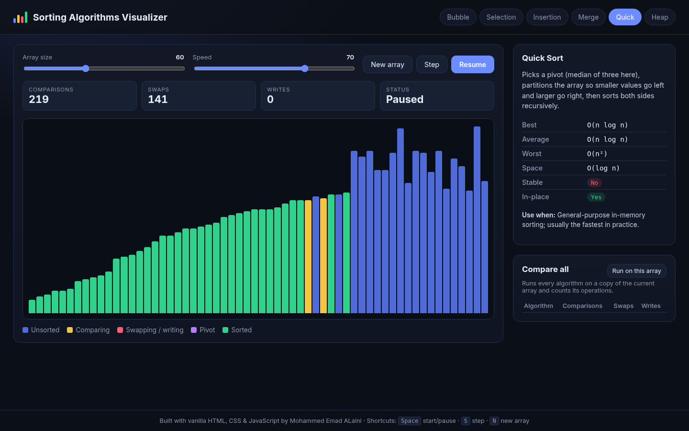
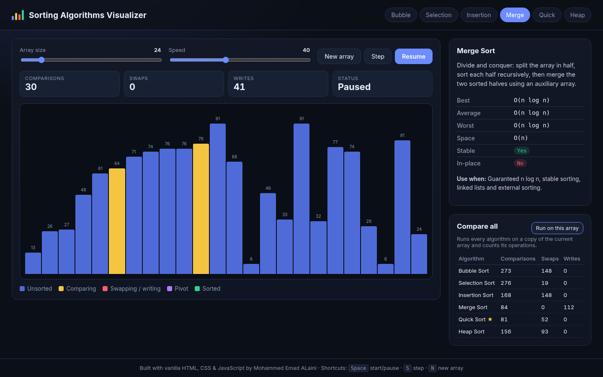
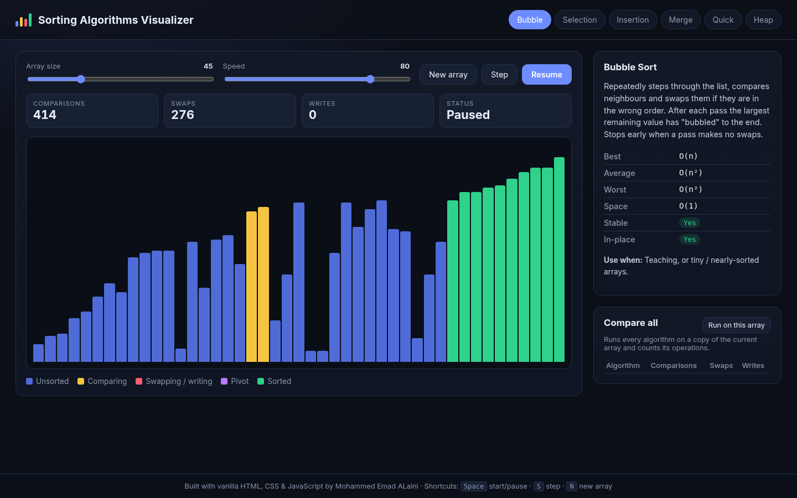
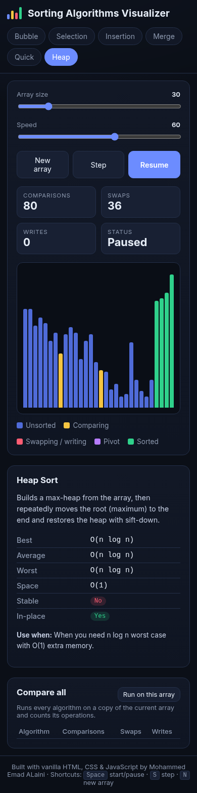

# Sorting Algorithms Visualizer

An interactive, animated visualizer for six classic sorting algorithms — watch every comparison and swap happen, control the speed and array size, and compare how many operations each algorithm needs on the same data. Pure HTML, CSS and JavaScript: no frameworks, no build step.

**Live demo:** https://mo-aini.github.io/sorting-algorithms-visualizer/




## Features

- **6 algorithms:** Bubble, Selection, Insertion, Merge, Quick (median-of-three pivot) and Heap sort
- **Animated bars** with colour states — comparing (yellow), swapping / writing (red), pivot (purple), sorted (green)
- **Live counters** for comparisons, swaps and writes (merge sort writes into an auxiliary array instead of swapping)
- **Controls:** array size slider (5–150), speed slider, Start / Pause / Resume, single **Step**, New array
- **Complexity panel** per algorithm — best / average / worst time, space, stable, in-place, and when to use it
- **Compare all:** runs every algorithm on a copy of the current array and shows a table of operation counts (fewest comparisons marked ★)
- **Keyboard shortcuts:** <kbd>Space</kbd> start/pause, <kbd>S</kbd> step, <kbd>N</kbd> new array
- **Shareable state via URL hash**, e.g. `index.html#algo=quick&size=60&speed=80&seed=11&autoplay=1` (seeded random arrays are reproducible)
- **Responsive dark UI** — works on phones (bar labels hide on small screens)
- **Unit tests** for all algorithms with Node's built-in test runner

## How It Works

Each algorithm in [`js/algorithms.js`](js/algorithms.js) is a **generator function**. It sorts the array in place and `yield`s a small step object whenever something interesting happens:

```js
function* bubbleSort(a) {
  for (let pass = 0; pass < a.length - 1; pass++) {
    for (let j = 0; j < a.length - 1 - pass; j++) {
      yield { type: "compare", i: j, j: j + 1 };
      if (a[j] > a[j + 1]) {
        [a[j], a[j + 1]] = [a[j + 1], a[j]];
        yield { type: "swap", i: j, j: j + 1 };
      }
    }
  }
}
```

The UI ([`js/visualizer.js`](js/visualizer.js)) calls `generator.next()` on a timer, repaints only the bars that changed and updates the counters. Because the algorithm code knows nothing about the DOM, the exact same functions are tested in Node.

## Complexity Cheat Sheet

| Algorithm | Best | Average | Worst | Space | Stable | In-place |
|---|---|---|---|---|---|---|
| Bubble | O(n) | O(n²) | O(n²) | O(1) | ✅ | ✅ |
| Selection | O(n²) | O(n²) | O(n²) | O(1) | ❌ | ✅ |
| Insertion | O(n) | O(n²) | O(n²) | O(1) | ✅ | ✅ |
| Merge | O(n log n) | O(n log n) | O(n log n) | O(n) | ✅ | ❌ |
| Quick | O(n log n) | O(n log n) | O(n²) | O(log n) | ❌ | ✅ |
| Heap | O(n log n) | O(n log n) | O(n log n) | O(1) | ❌ | ✅ |

## Screenshots

Merge sort with value labels, plus the **Compare all** table for the same 24-element array:



Bubble sort — the largest values have already "bubbled" to the right (green):





## Tech Stack

- HTML5, CSS3 (CSS variables, grid, flexbox, media queries)
- Vanilla JavaScript (ES2020 generators, `URLSearchParams`)
- Node.js built-in test runner (`node:test`) for the algorithm tests — no dependencies

## Project Structure

```
sorting-algorithms-visualizer/
├── index.html            # page layout
├── css/style.css         # dark responsive theme
├── js/
│   ├── algorithms.js     # 6 sorting generators + countOperations()
│   ├── complexity.js     # info panel data
│   └── visualizer.js     # DOM rendering, animation loop, controls
├── tests/algorithms.test.js
├── screenshots/
└── package.json          # npm test
```

## How to Run

No installation needed:

```bash
git clone https://github.com/Mo-aini/sorting-algorithms-visualizer.git
cd sorting-algorithms-visualizer
# open index.html in your browser, or serve the folder:
python3 -m http.server 8000      # then visit http://localhost:8000
```

Run the tests (Node 18+):

```bash
npm test
```

The tests check every algorithm on empty, single, sorted, reversed, duplicate and random arrays, that all reported indices are valid, that bubble/insertion sort are O(n) on sorted input, that selection sort always makes n(n−1)/2 comparisons, and that merge sort is stable.

## What I Learned

- Using JavaScript generators to pause an algorithm mid-way — a clean way to animate any step-by-step process
- Separating logic from presentation so the same code can be unit-tested in Node and animated in the browser
- Seeing Big-O visually: with 150 elements, bubble sort needs thousands of comparisons while merge/quick sort need around a thousand
- Why quick sort needs a good pivot (median of three avoids the O(n²) case on already sorted input)
- Making a responsive layout with CSS grid and media queries

## Author

**Mohammed Emad ALaini** — BS Software Engineering, Superior University

## License

MIT — see [LICENSE](LICENSE).
